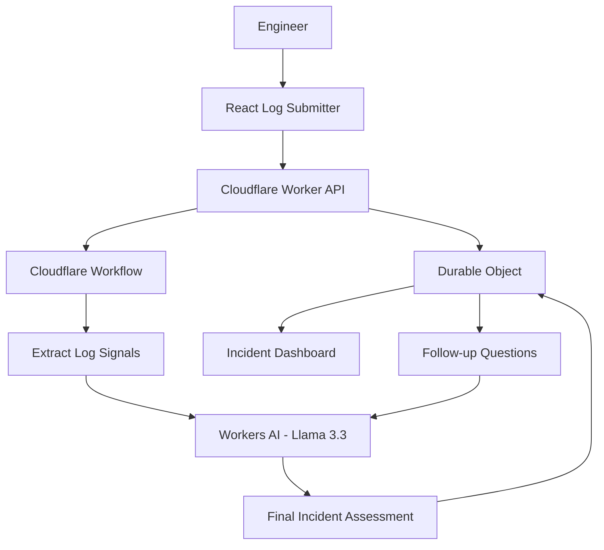

# IncidentLens Architecture

## High-level flow



## Request lifecycle

### 1. Log submission

The frontend sends:

```http
POST /api/incidents
Content-Type: application/json
```

with:

```json
{
  "logs": "..."
}
```

The Worker creates an incident ID.

### 2. State initialization

A Durable Object is created for that incident.

The object stores:
- incident ID
- submitted logs
- status
- analysis result
- conversation messages

### 3. Workflow execution

The Worker starts an `IncidentInvestigationWorkflow`.

The Workflow runs multiple durable steps:

```text
extract log signals
        ↓
analyze logs with AI
        ↓
save investigation
        ↓
produce final incident report
        ↓
save final result
```

### 4. AI investigation

Workers AI runs Llama 3.3.

The model is instructed to:
- use supplied evidence only
- identify severity
- identify likely root cause
- produce alternative hypotheses
- recommend actions
- distinguish facts from hypotheses

### 5. Persistent memory

The Durable Object stores the investigation messages and final result.

A follow-up question can therefore use the previous incident context without the user resubmitting the logs.

## Why each Cloudflare service is used

| Component | Responsibility |
|---|---|
| Workers | API and application logic |
| Workers AI | LLM inference |
| Workflows | Durable investigation pipeline |
| Durable Objects | Per-incident state and memory |
| Pages | Frontend hosting |

## Data model

### Incident

```text
id
report       ← submitted logs
status
result       ← final AI assessment
created_at
```

### Message

```text
id
role
content
ts
```

The prototype uses the Durable Object's embedded SQLite storage.

## Trust boundary

IncidentLens treats uploaded logs as evidence, not as instructions.

The model is explicitly told not to invent telemetry or evidence. This is important because incident-response output can otherwise sound more certain than the underlying data supports.
